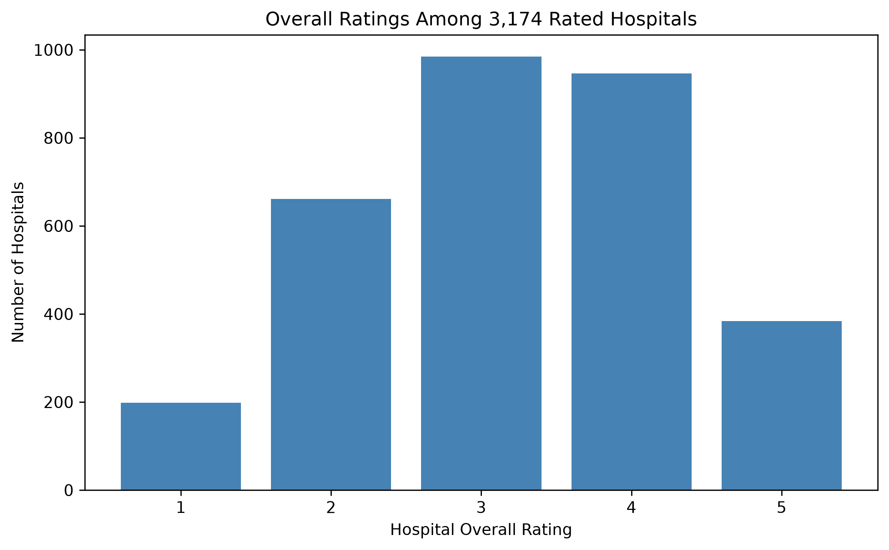

# Hospital Quality Analysis

By Harshini Reddy Jakkidi

## Project Overview

This project uses Python and MySQL to explore hospital ratings, hospital types, and geographic distribution across 5,419 hospital records.

The analysis also examines missing ratings and includes a closer look at hospitals in Texas.

## Tools Used

- Python: Pandas, NumPy, Matplotlib, and Seaborn
- Jupyter Notebook
- MySQL Workbench
- GitHub

## Data Preparation

- Checked for duplicate records.
- Preserved facility identifiers as text.
- Removed extra spaces from text fields.
- Converted hospital ratings to numeric values.
- Kept unavailable ratings as missing rather than replacing them with zero.
- Added a rating-status column to distinguish rated and unrated hospitals.

## Key Findings

| Measure | Result |
| --- | ---: |
| Total hospital records | 5,419 |
| Hospitals with ratings | 3,174 |
| Hospitals without ratings | 2,245 |
| Average rating among rated hospitals | 3.21 / 5 |
| Acute care hospitals | 3,107 |
| Texas hospitals | 467 |
| Texas hospitals with ratings | 216 |
| Average rating among rated Texas hospitals | 3.38 / 5 |

### Hospital Rating Distribution

| Rating | Hospital Count |
| --- | ---: |
| 1 star | 198 |
| 2 stars | 661 |
| 3 stars | 985 |
| 4 stars | 946 |
| 5 stars | 384 |
| Missing | 2,245 |

## SQL Analysis

The SQL script includes queries to:

1. Count all hospital records.
2. Preview hospital records.
3. Count hospitals by state.
4. Count hospitals by type.
5. Summarize ratings, including missing values.
6. Calculate the average rating among rated hospitals.
7. Summarize Texas hospitals.
8. List five-star hospitals in Texas.

## Project Files

- `data/`: Original and cleaned hospital datasets.
- `notebooks/hospital_quality_analysis.ipynb`: Python data cleaning and analysis.
- `hospital_analysis.sql`: MySQL analysis queries.
- `hospital_counts_by_rating.csv`: Exported hospital counts by rating.
- `hospital_counts_by_state.csv`: Exported hospital counts by state.
- `images/hospital_rating_distribution_final.png`: Rating distribution chart.

## Running the Analysis

### Python

1. Download the repository and extract it.
2. Install pandas, numpy, matplotlib, seaborn, and Jupyter Notebook.
3. Confirm that the original dataset is saved as `data/raw/hospital_general_information.csv`.
4. Ensure the `data/processed` and `images` folders exist.
5. Open `notebooks/hospital_quality_analysis.ipynb` in Jupyter Notebook.
6. Run the cells from top to bottom.

### MySQL

1. Create a database named `hospital_quality_db`.
2. Import the cleaned dataset into a table named `hospitals_complete`.
3. Use text columns during import to preserve identifiers and avoid conversion errors.
4. Confirm that 5,419 records were imported.
5. Open `hospital_analysis.sql` in MySQL Workbench and run the queries.

## Limitations

Approximately 41.4% of hospital records have no overall rating. Average ratings exclude these records.

Rating availability differs across hospital types and locations, so comparisons should consider how many hospitals are rated. Findings describe the dataset used and do not establish causes of differences in hospital quality.
